# RuangDegup — Sistem Informasi Perpustakaan Digital
**SMKN 6 Surakarta • Ruang Cerita, Ruang Rasa**

[](https://laravel.com)
[](https://react.dev)
[](https://vitejs.dev)
[](https://www.mysql.com)
[](https://railway.com)

---

## 📌 1. Deskripsi Proyek

**RuangDegup** adalah platform sistem informasi perpustakaan berbasis web dengan pendekatan kurasi editorial yang hangat (*warm editorial aesthetic*). Aplikasi ini dirancang untuk mendigitalkan proses pencarian katalog buku, sirkulasi peminjaman dan pengembalian mandiri oleh siswa, pengelolaan rak favorit, serta apresiasi ulasan buku di **SMKN 6 Surakarta**.

Sistem ini dibangun dengan arsitektur modern: **Laravel 12 REST API** sebagai backend dan **React 19 SPA + Vite 8** sebagai frontend, didukung autentikasi berbasis token **Laravel Sanctum**.

* **Live Website Publik:** [https://ruangdegup.web.id](https://ruangdegup.web.id)
* **Backend API Base:** [https://api.ruangdegup.web.id](https://api.ruangdegup.web.id)
* **Repositori GitHub:** [Bianca3020/RuangDegup](https://github.com/Bianca3020/RuangDegup)

---

## 👥 2. Akun Demo Pengujian

Penguji / Guru dapat menggunakan akun pengujian khusus berikut untuk menguji masing-masing hak akses pada lingkungan lokal atau demo:

| Peran | Email | Kata Sandi | Keterangan Akses |
| :--- | :--- | :--- | :--- |
| **Admin (Petugas)** | `admin@ruangdegup.com` | `admin123` *(atau sesuai seeder)* | Akses penuh Dashboard Admin, CRUD Buku, Kategori, Anggota Siswa, Peminjaman, Ekspor Laporan PDF, & Kutipan Footer. |
| **Member (Siswa)** | `bianca@ruangdegup.local` | `RuangDegup123!` *(atau sesuai seeder)* | Akses Ruang Anggota, pinjam buku fisik, kembalikan buku mandiri, simpan rak favorit, & tulis ulasan. |

> **Catatan:** Pengguna umum juga dapat langsung membuat akun Member siswa baru melalui tombol **Daftar** pada modal autentikasi. Pastikan untuk mengganti kata sandi default apabila aplikasi digunakan di lingkungan produksi.

---

## 🚀 3. Fitur Utama & Kriteria Pemenuhan Tugas

### A. Autentikasi & Multi-Role (Admin & Member)
- Sistem login & registrasi terintegrasi dengan validasi kredensial.
- Pembatasan rute dan otorisasi ketat menggunakan token **Laravel Sanctum** serta middleware role (`admin` & `member`).
- Session view tersimpan aman (`sessionStorage` + sinkronisasi URL Hash) sehingga tidak ter-reset ke halaman beranda saat halaman dimuat ulang.

### B. Manajemen Katalog Buku & Pencarian (CRUD Lengkap)
- **Katalog Buku:** Tambah, baca, perbarui metadata buku (ISBN, penulis, penerbit, tahun terbit, stok, sinopsis), dan hapus buku.
- **Upload Sampul:** Mendukung unggah berkas gambar foto sampul fisik maupun tautan URL gambar eksternal.
- **Kategori Koleksi:** CRUD klasifikasi kategori buku dengan proteksi integritas relasi database (`RESTRICT`).
- **Pencarian Real-Time (Live Search):** Filter buku instan berdasarkan judul, nama penulis, maupun ISBN tanpa perlu me-reload halaman.
- **Baru Menghiasi Rak (New Arrivals):** Section koleksi 6 buku terbaru terurut berdasarkan tanggal penambahan (`created_at DESC`).

### C. Sirkulasi Peminjaman & Pengembalian Mandiri
- Peminjaman buku fisik oleh siswa dengan verifikasi stok tersedia dan batas waktu pengembalian 7 hari.
- **Manajemen Stok Otomatis:** Stok buku di database otomatis berkurang saat dipinjam dan bertambah kembali saat buku dikembalikan.
- Transaksi dilindungi mekanisme transaksi database atomik (`DB::transaction` dengan `lockForUpdate`) untuk mencegah *race condition*.

### D. Interaksi Siswa (Favorit & Ulasan)
- **Rak Buku Favorit:** Siswa dapat menandai hingga 4 buku favorit pilihan di dashboard.
- **Catatan Apresiasi & Ulasan:** Siswa dapat memberikan rating (1–5 bintang) beserta ulasan tertulis (1 ulasan per siswa per buku).

### E. Laporan Transaksi Peminjaman (Ekspor PDF)
- Admin dapat mencetak dan mengunduh laporan sirkulasi perpustakaan dalam format **PDF** (`barryvdh/laravel-dompdf`).
- Mendukung filter status laporan: *Semua Riwayat*, *Sedang Dipinjam*, *Telah Dikembalikan*, serta indikator keterlambatan.

### F. Dynamic Editorial Footer Quotes
- Kutipan sastra & inspiratif di footer publik yang berganti secara dinamis di setiap kunjungan baru.
- Dilengkapi tautan publikasi Substack `https://substack.com/@ruangdegup`.
- Admin dapat mengelola, menambah, mengubah, mengaktifkan/menonaktifkan, serta menghapus kutipan melalui Admin Panel.

---

## 🔒 4. Keamanan Sistem Dasar

1. **Password Hashing:** Semua kata sandi akun dienkripsi menggunakan algoritma hashing **Bcrypt** (`Hash::make`).
2. **Prepared Statements:** Seluruh interaksi database menggunakan Laravel Eloquent ORM dan PDO binding untuk mencegah celah **SQL Injection**.
3. **Validasi Input Ketat:** Setiap data masukan divalidasi ketat pada Controller dengan rules MIME type, batas ukuran berkas, tipe data integer, dan sanitasi string.
4. **Proteksi Otorisasi:** Endpoint sensitif admin dilindungi middleware `auth:sanctum` dan middleware role `admin`.

---

## 📱 5. Tampilan Responsif (Mobile Friendly)

Antarmuka web dirancang responsif dan fleksibel menggunakan *CSS Grid*, *Flexbox*, dan *Media Queries* sehingga nyaman diakses melalui:
- **Smartphone / HP** (layar 320px – 480px)
- **Tablet / iPad** (layar 768px – 1024px)
- **Laptop & Desktop Monitor** (1280px+)

---

## 🗄️ 6. Rancangan Basis Data & ERD

### Diagram ERD (Entity Relationship Diagram)

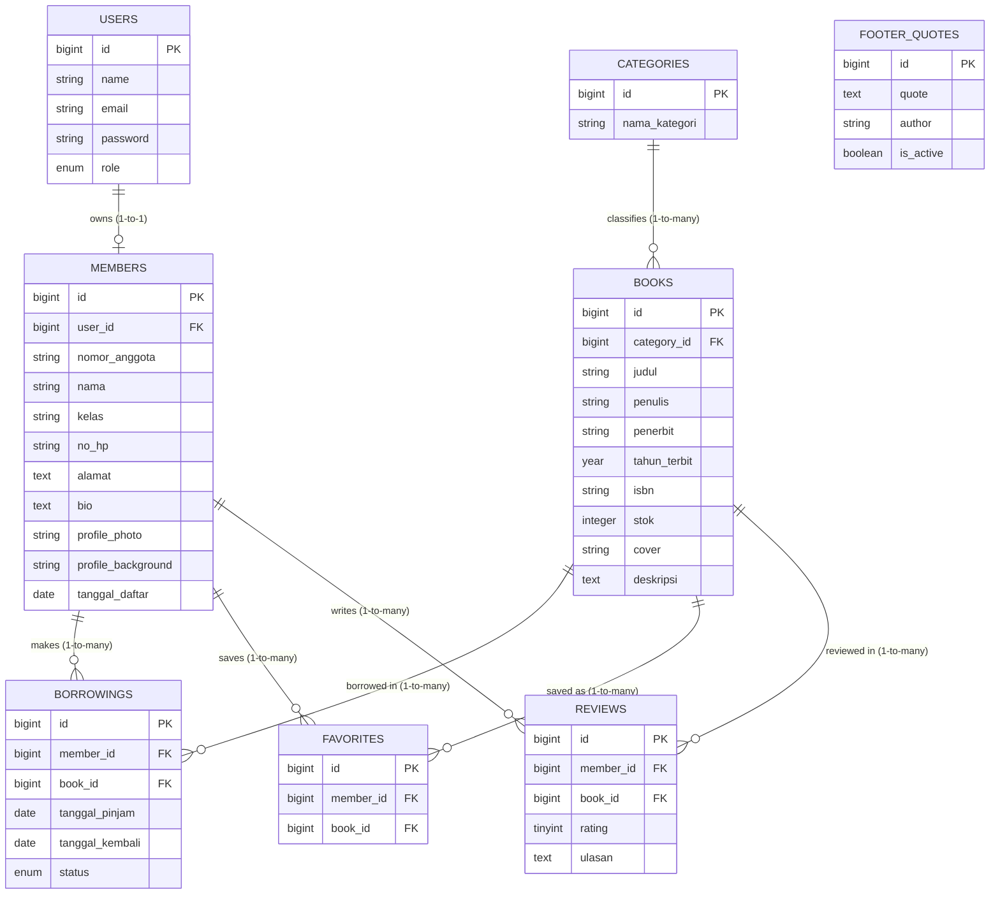

> File gambar vektor ERD lengkap tersedia pada berkas [erd-ruangdegup.svg](./erd-ruangdegup.svg).

---

## 🛠️ 7. Panduan Instalasi Lokal (Local Development)

### Prasyarat Sistem
* PHP >= 8.2 (ekstensi `pdo_mysql`, `gd`, `fileinfo`, `mbstring` aktif)
* Composer 2.x
* Node.js >= 18.x & npm
* MySQL / MariaDB (misal via XAMPP)

### Langkah-Langkah

1. **Clone Repositori:**
   ```bash
   git clone https://github.com/Bianca3020/RuangDegup.git
   cd RuangDegup
   ```

2. **Setup Backend (Laravel):**
   ```bash
   # Salin berkas lingkungan
   cp .env.example .env

   # Install dependencies PHP
   composer install

   # Generate Application Key
   php artisan key:generate

   # Buat symbolic link folder storage publik
   php artisan storage:link

   # Jalankan migrasi dan seeder database
   php artisan migrate --seed
   ```

3. **Setup Frontend (React + Vite):**
   ```bash
   cd frontend
   npm install
   npm run build
   cd ..
   ```

4. **Menjalankan Server:**
   ```bash
   # Terminal 1: Backend
   php artisan serve

   # Terminal 2: Frontend (mode dev)
   cd frontend
   npm run dev
   ```
   Akses aplikasi di browser pada: `http://localhost:5173` atau `http://localhost:8000`.

---

## 📄 8. Lisensi & Hak Cipta

Dikembangkan oleh **Bianca** untuk tugas akhir kejuruan **SMKN 6 Surakarta**.  
Hak Cipta © 2026 **RuangDegup**. Seluruh hak dilindungi undang-undang.

---

## 🖼️ 9. Preview Website & Dokumentasi Antarmuka

Berikut adalah tangkapan layar aktual dari aplikasi **RuangDegup** yang sedang berjalan pada resolusi desktop (1920×1080):

### A. Public Interface
| Tampilan | Preview |
| :--- | :--- |
| **Homepage & Hero Section**<br>Navigasi utama, identitas RuangDegup, tagline *Ruang Cerita, Ruang Rasa*, dan hero carousel editorial. | 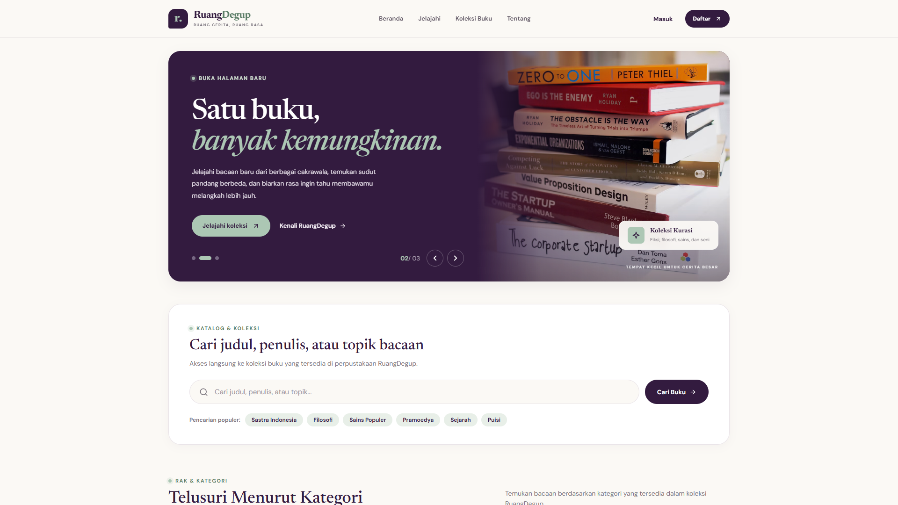 |
| **Katalog Buku & Pencarian**<br>Daftar buku lengkap dengan kolom pencarian instan (judul, penulis, ISBN) dan filter kategori. | 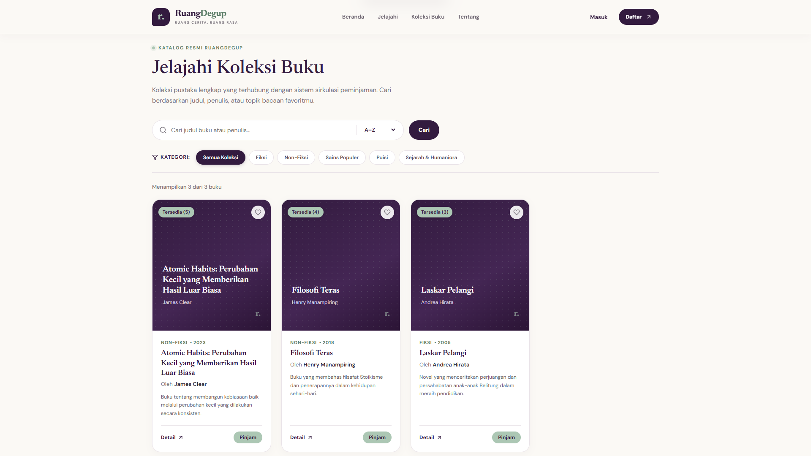 |
| **Baru Menghiasi Rak**<br>Section koleksi 6 buku fisik terbaru yang siap dipinjam oleh siswa. | 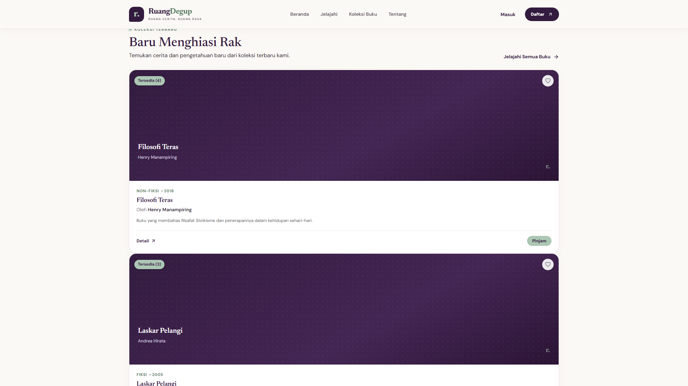 |
| **Detail Buku & Ulasan Komunitas**<br>Modal detail buku menampilkan cover, sinopsis, penerbit, tahun terbit, ISBN, stok, tombol pinjam, dan ulasan siswa. | 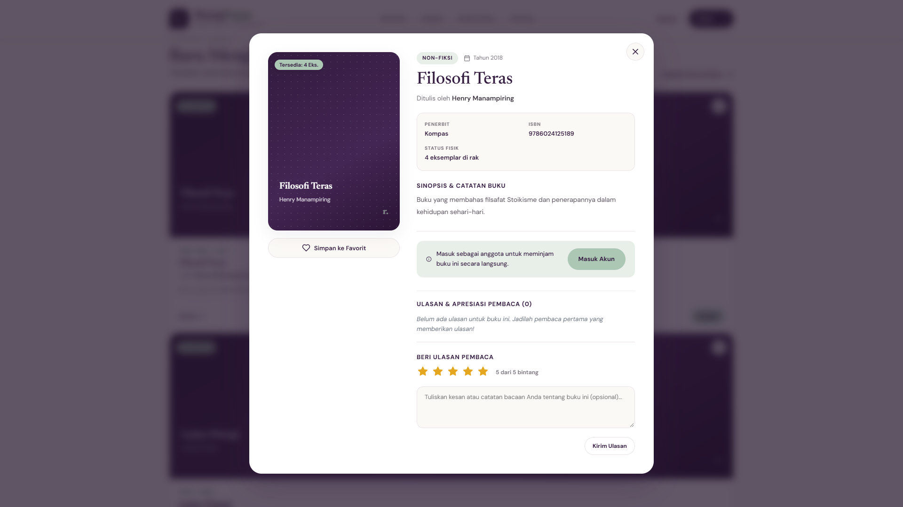 |

### B. Admin Interface (Petugas Perpustakaan)
| Tampilan | Preview |
| :--- | :--- |
| **Admin Dashboard**<br>Ringkasan metrik perpustakaan (total judul, stok, kategori, anggota, pinjaman aktif, terlambat) dan aksi cepat sirkulasi. | 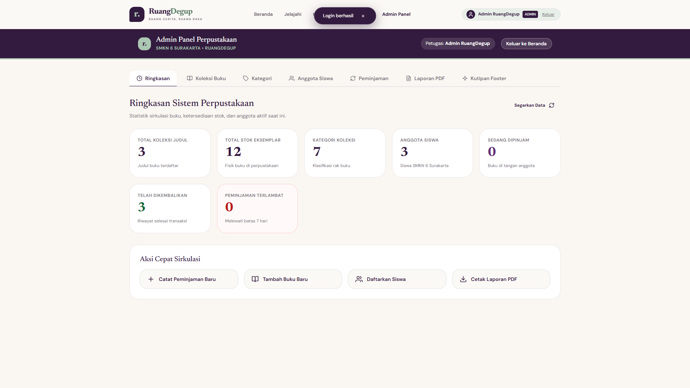 |
| **Manajemen Koleksi Buku**<br>Tabel inventaris buku dengan pencarian, filter kategori, informasi stok, serta aksi edit & hapus. | 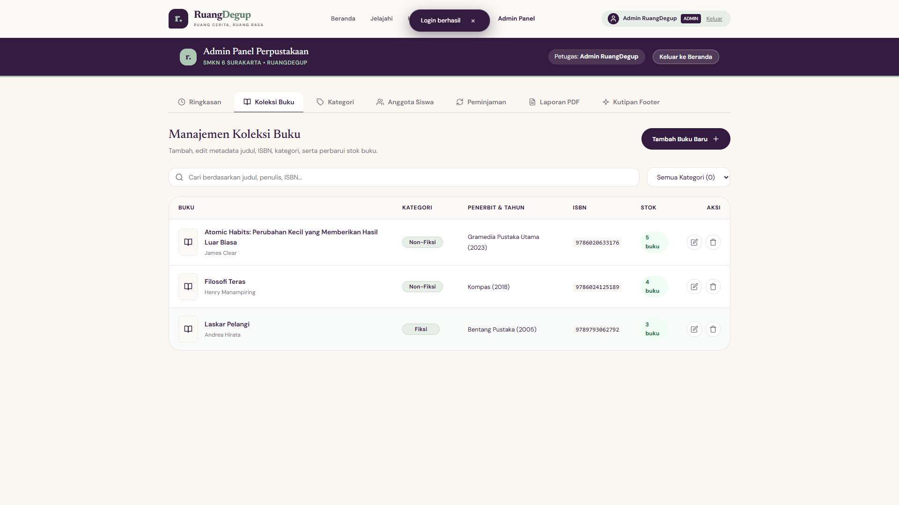 |
| **Form Tambah / Edit Buku**<br>Modal pengisian metadata buku, stok fisik, sinopsis, dan unggah foto sampul atau tautan URL. | 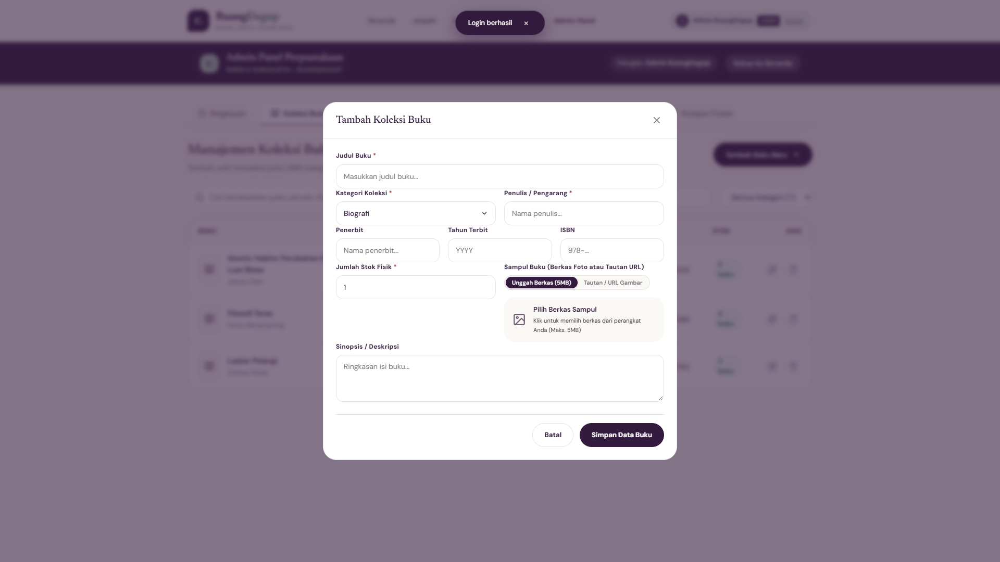 |
| **Manajemen Kategori**<br>Daftar klasifikasi rak kategori beserta jumlah buku terkait pada setiap kategori. | 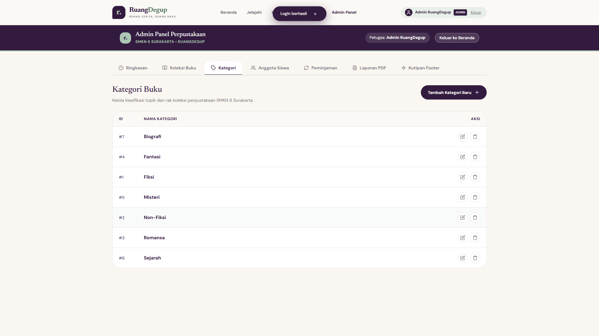 |
| **Manajemen Anggota Siswa**<br>Data anggota siswa SMKN 6 Surakarta berdasarkan tingkat kelas dan 7 kompetensi keahlian. | 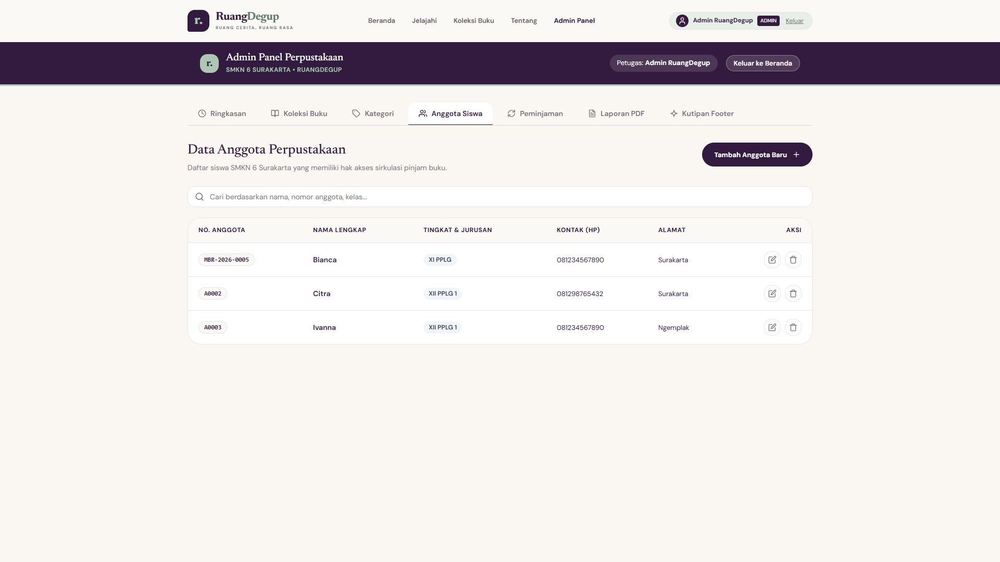 |
| **Sirkulasi Peminjaman & Pengembalian**<br>Meja transaksi peminjaman manual oleh petugas, tanggal jatuh tempo, dan status pengembalian. | 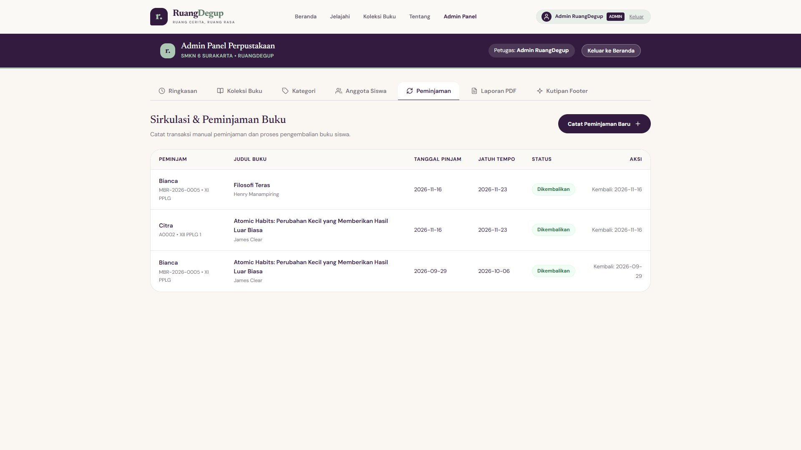 |
| **Laporan Sirkulasi & Ekspor PDF**<br>Rekapitulasi transaksi dengan filter status dinamis dan tombol *Unduh Laporan PDF*. | 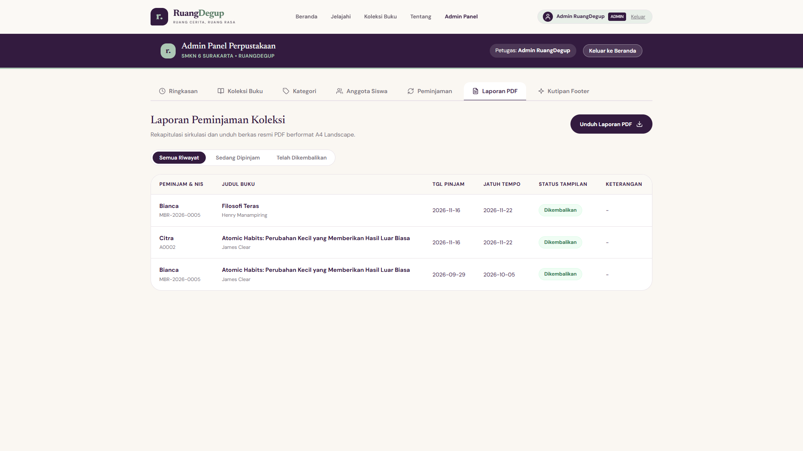 |
| **Manajemen Kutipan Editorial**<br>Pengelolaan kutipan literasi footer publik dilengkapi sakelar aktivasi (*toggle switch*) instan. | 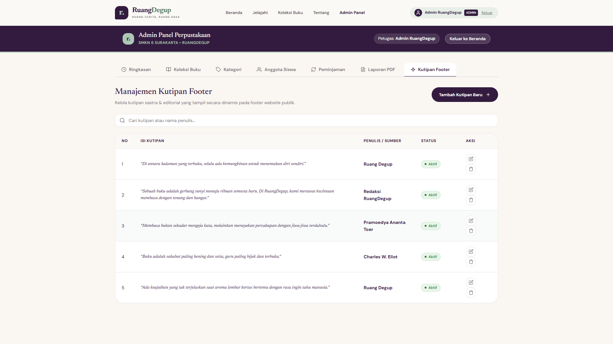 |

### C. Member Interface (Siswa)
| Tampilan | Preview |
| :--- | :--- |
| **Member Dashboard (Ruang Anggota)**<br>Identitas siswa, nomor anggota digital, kelas, ringkasan statistik sirkulasi, favorit, dan ulasan. | 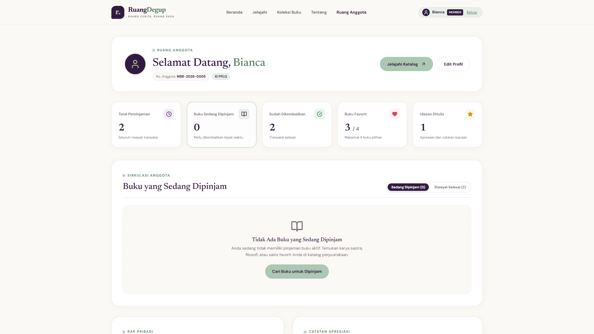 |
| **Peminjaman & Riwayat Transaksi**<br>Daftar buku yang sedang dipinjam maupun riwayat pengembalian yang telah selesai. | 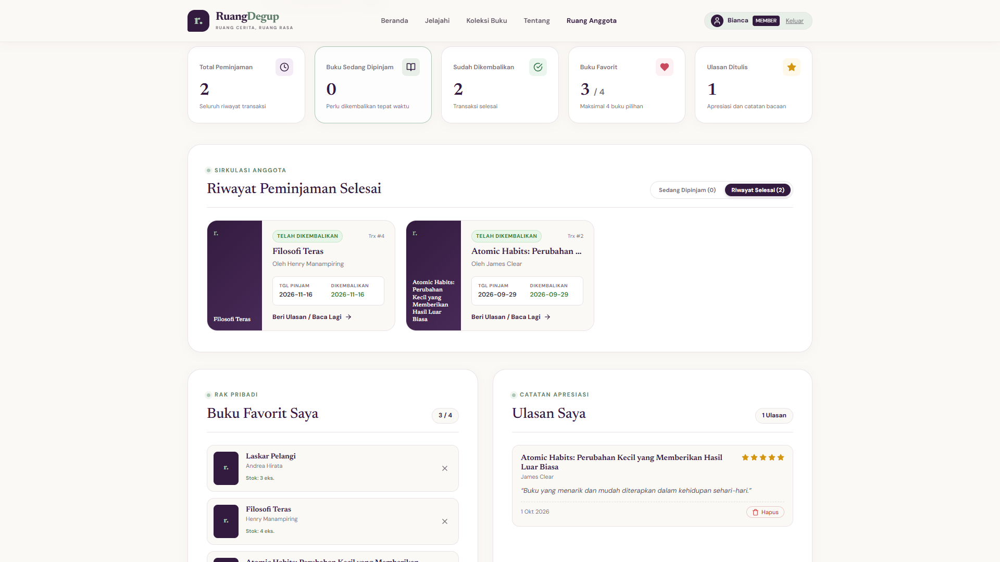 |
| **Rak Buku Favorit**<br>Koleksi personal maksimal 4 buku favorit pilihan siswa pada Ruang Anggota. | 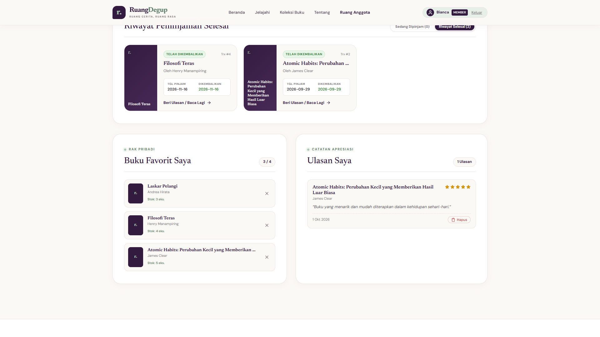 |
| **Ulasan & Apresiasi Siswa**<br>Daftar catatan refleksi bacaan dan rating bintang yang ditulis oleh siswa. | 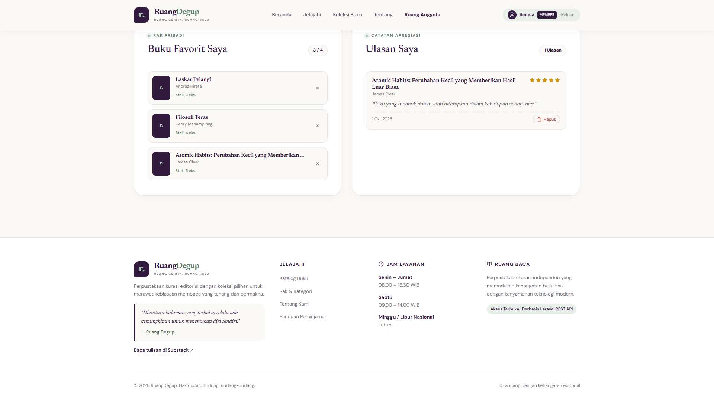 |
| **Profil Siswa & Kartu Anggota Digital**<br>Kartu keanggotaan digital SMKN 6 Surakarta, pengaturan biodata, kontak WhatsApp, bio, avatar, dan cover. | 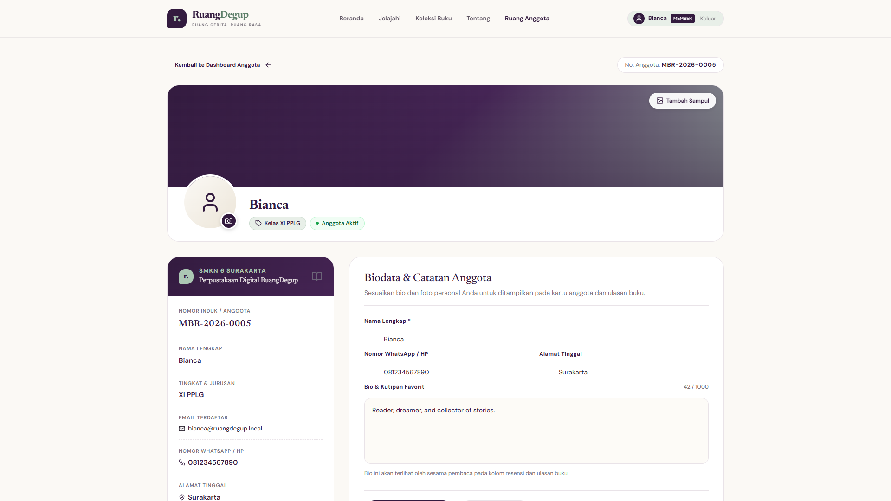 |
| **Pengaturan Keamanan & Password**<br>Form pembaruan kata sandi siswa (password lama, baru, dan konfirmasi) dengan enkripsi Bcrypt. | 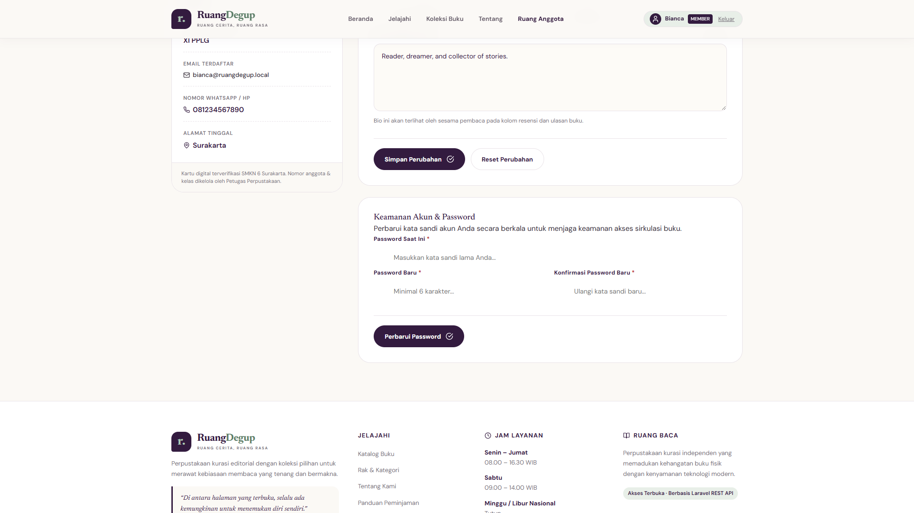 |
