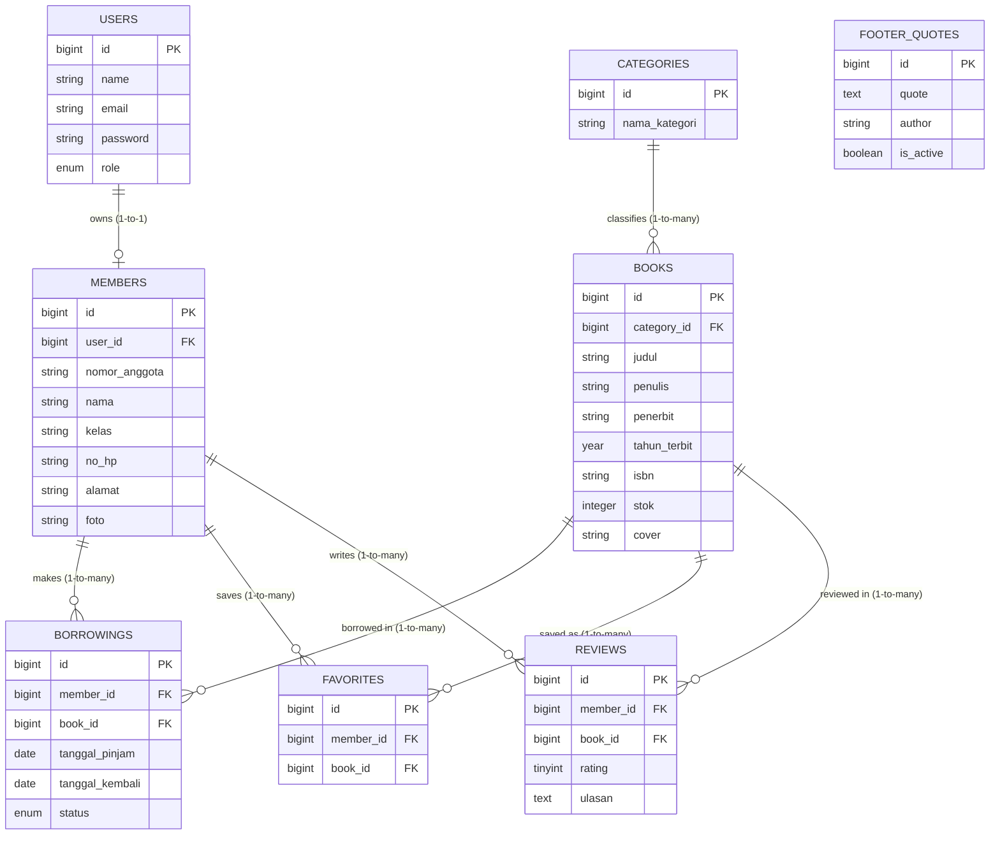

# RuangDegup — Sistem Informasi Perpustakaan Digital
**SMKN 6 Surakarta • Ruang Cerita, Ruang Rasa**

[](https://laravel.com)
[](https://react.dev)
[](https://vitejs.dev)
[](https://www.mysql.com)
[](https://railway.com)

---

## 📌 1. Deskripsi Proyek

**RuangDegup** adalah platform sistem informasi perpustakaan berbasis web dengan pendekatan kurasi editorial yang hangat (*warm editorial aesthetic*). Aplikasi ini dirancang untuk mendigitalkan proses pencarian katalog buku, sirkulasi peminjaman dan pengembalian mandiri oleh siswa, pengelolaan rak favorit, serta apresiasi ulasan buku di **SMKN 6 Surakarta**.

Sistem ini dibangun dengan arsitektur modern: **Laravel 11 REST API** sebagai backend dan **React SPA + Vite** sebagai frontend, didukung autentikasi berbasis token **Laravel Sanctum**.

* **Live Website Publik:** [https://ruangdegup.web.id](https://ruangdegup.web.id)
* **Backend API Base:** [https://api.ruangdegup.web.id](https://api.ruangdegup.web.id)
* **Repositori GitHub:** [Bianca3020/RuangDegup](https://github.com/Bianca3020/RuangDegup)

---

## 👥 2. Akun Demo Pengujian

Penguji / Guru dapat menggunakan kredensial berikut untuk menguji masing-masing hak akses:

| Peran | Email | Kata Sandi | Keterangan Akses |
| :--- | :--- | :--- | :--- |
| **Admin (Petugas)** | `admin@ruangdegup.com` | `admin123` | Akses penuh Dashboard Admin, CRUD Buku, Kategori, Anggota Siswa, Peminjaman, Ekspor Laporan PDF, & Quotes Footer. |
| **Member (Siswa)** | `bianca@gmail.com` *(atau daftar akun baru)* | `password123` | Akses Ruang Anggota, pinjam buku fisik, kembalikan buku mandiri, simpan rak favorit, & tulis ulasan. |

> **Catatan:** Pengguna umum juga dapat langsung membuat akun Member siswa baru melalui tombol **Daftar** di modal login.

---

## 🚀 3. Fitur Utama & Kriteria Pemenuhan Tugas

### A. Autentikasi & Multi-Role (Admin & Member)
- Sistem login & registrasi terintegrasi dengan validasi kredensial.
- Pembatasan rute dan otorisasi ketat menggunakan token **Laravel Sanctum**.
- Session view tersimpan aman (`sessionStorage` + URL Hash sync) sehingga tidak ter-reset ke halaman beranda saat direfresh.

### B. Manajemen Katalog Buku & Pencarian (CRUD Lengkap)
- **Katalog Buku:** Tambah, baca, perbarui metadata buku (ISBN, penulis, penerbit, tahun terbit, stok), dan hapus buku.
- **Upload Sampul:** Mendukung unggah berkas gambar foto sampul fisik (JPEG, PNG, JPG, WebP, GIF, JFIF hingga 10MB) maupun tautan URL eksternal.
- **Kategori Koleksi:** CRUD klasifikasi kategori buku.
- **Pencarian Real-Time (Live Search):** Filter buku instan berdasarkan judul, nama penulis, maupun ISBN tanpa perlu me-reload halaman.
- **Baru Menghiasi Rak (New Arrivals):** Section koleksi 6 buku terbaru terurut berdasarkan tanggal penambahan (`created_at DESC`).

### C. Sirkulasi Peminjaman & Pengembalian Mandiri
- Peminjaman buku fisik oleh siswa dengan verifikasi stok tersedia.
- **Manajemen Stok Otomatis:** Stok buku di database otomatis berkurang saat dipinjam dan bertambah kembali saat buku dikembalikan.
- Transaksi dilindungi mekanisme transaksi database atomik (`DB::transaction` dengan `lockForUpdate`) untuk mencegah race condition.

### D. Interaksi Siswa (Favorit & Ulasan)
- **Rak Buku Favorit:** Siswa dapat menandai hingga 4 buku favorit pilihan.
- **Catatan Apresiasi & Ulasan:** Siswa dapat memberikan rating (1–5 bintang) beserta ulasan tertulis. Data ulasan otomatis ter-update seketika di dashboard tanpa perlu refresh manual.

### E. Laporan Transaksi Peminjaman (Ekspor PDF)
- Admin dapat mencetak dan mengunduh laporan sirkulasi perpustakaan dalam format **PDF**.
- Mendukung filter status laporan: *Semua Transaksi*, *Sedang Dipinjam*, *Sudah Dikembalikan*, dan *Jatuh Tempo / Terlambat*.

### F. Dynamic Editorial Footer Quotes
- Kutipan sastra & inspiratif di footer publik yang berganti secara dinamis di setiap kunjungan baru (menggunakan mekanisme `localStorage` agar tidak berulang berturut-turut).
- Dilengkapi tautan publikasi Substack `https://substack.com/@ruangdegup`.
- Admin dapat mengelola, menambah, mengubah, menonaktifkan/mengaktifkan, serta menghapus kutipan via Admin Panel.

---

## 🔒 4. Keamanan Sistem Dasar

1. **Password Hashing:** Semua kata sandi akun dienkripsi menggunakan algoritma hashing **Bcrypt** (`Hash::make`).
2. **Prepared Statements:** Seluruh interaksi database menggunakan Laravel Eloquent ORM dan PDO binding untuk mencegah celah **SQL Injection**.
3. **Validasi Input Ketat:** Setiap data masukan divalidasi ketat pada Controller dengan rules MIME type, batas ukuran berkas, tipe data integer, dan sanitasi string.
4. **Proteksi Otorisasi:** Endpoint sensitif admin (seperti CRUD buku dan laporan sirkulasi) dilindungi middleware `auth:sanctum` dan middleware role `admin`.

---

## 📱 5. Tampilan Responsif (Mobile Friendly)

Antarmuka web dirancang responsif dan fleksibel menggunakan *CSS Grid*, *Flexbox*, dan *Media Queries* sehingga nyaman diakses melalui:
- **Smartphone / HP** (layar 320px – 480px)
- **Tablet / iPad** (layar 768px – 1024px)
- **Laptop & Desktop Monitor** (1280px+)

---

## 🗄️ 6. Rancangan Basis Data & ERD

### Diagram ERD (Entity Relationship Diagram)



> File gambar vektor ERD lengkap berkualitas tinggi tersedia pada berkas [erd-ruangdegup.svg](./erd-ruangdegup.svg).

---

## 🛠️ 7. Panduan Instalasi Lokal (Local Development)

### Prasyarat Sistem
* PHP >= 8.2 (ekstensi `pdo_mysql`, `gd`, `fileinfo`, `mbstring` aktif)
* Composer 2.x
* Node.js >= 18.x & npm
* MySQL / MariaDB (misal via XAMPP)

### Langkah-Langkah

1. **Clone Repositori:**
   ```bash
   git clone https://github.com/Bianca3020/RuangDegup.git
   cd RuangDegup
   ```

2. **Setup Backend (Laravel):**
   ```bash
   # Salin berkas lingkungan
   cp .env.example .env

   # Install dependencies PHP
   composer install

   # Generate Application Key
   php artisan key:generate

   # Buat symbolic link folder storage publik
   php artisan storage:link

   # Jalankan migrasi dan seeder database
   php artisan migrate --seed
   ```

3. **Setup Frontend (React + Vite):**
   ```bash
   cd frontend
   npm install
   npm run build
   cd ..
   ```

4. **Menjalankan Server:**
   ```bash
   # Terminal 1: Backend
   php artisan serve

   # Terminal 2: Frontend (mode dev)
   cd frontend
   npm run dev
   ```
   Akses aplikasi di browser pada: `http://localhost:5173` atau `http://localhost:8000`.

---

## 📄 8. Lisensi & Hak Cipta

Dikembangkan oleh **Bianca** untuk tugas akhir kejuruan **SMKN 6 Surakarta**.  
Hak Cipta © 2026 **RuangDegup**. Seluruh hak dilindungi undang-undang.
